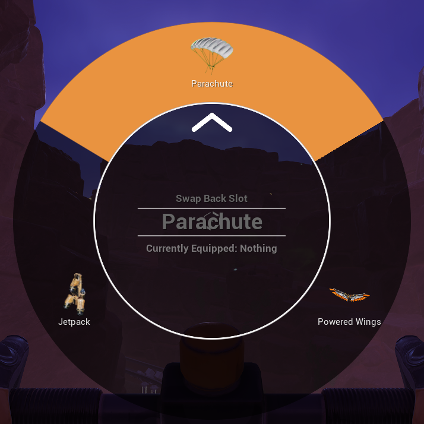

# Back Slot Radial

A [Satisfactory](https://www.satisfactorygame.com/) mod that swaps your back slot from a radial
menu. Hold a key, flick the mouse at the Jetpack, Parachute or Hover Pack you want, and let go.
No more opening the inventory mid-air.

Built with [SML](https://ficsit.app/mod/SML) (Satisfactory Mod Loader).

## Features

- Hold **R** on foot to open the menu. It's rebindable under Options > Controls.
- The menu lists everything in your inventory that fits your back slot. Release over one to
  equip it, swapping out whatever you're wearing.
- The **X** at the top unequips your back item into an empty inventory slot.
- The arrow follows the mouse with no dead zone, and the wedge under it is selected from the
  moment the menu opens. A quick hold and release picks the top wedge.
- Looks and sounds like the game's own build-mode radial
- Works with back equipment added by other mods, such as Wing Development. The menu asks the
  back slot itself what fits, so no per-mod support is needed.
- Stays out of the way while building, holding a weapon (R reloads), driving, or in menus

## Known limitations

- Tested in single player only. Multiplayer and dedicated servers are untested. Swaps run on
  the server, so they should work there too.
- Unequipping needs a free inventory slot. With a full inventory the X does nothing.

## Installation

Install via the [Satisfactory Mod Manager](https://ficsit.app/).

## Building from source

1. Clone into `<SML>/Mods/GameFeatures/BackSlotRadial` (or symlink/junction it there).
2. Generate project files and build the `FactoryEditor` target as you would for SML.
3. Package with Alpakit.

The menu is drawn entirely in C++, so there is no widget Blueprint. The input action, key
mapping and game feature data are created by `Tools/create_assets.py`, run headlessly through
the editor's Python commandlet. See the comment at the top of the script.
